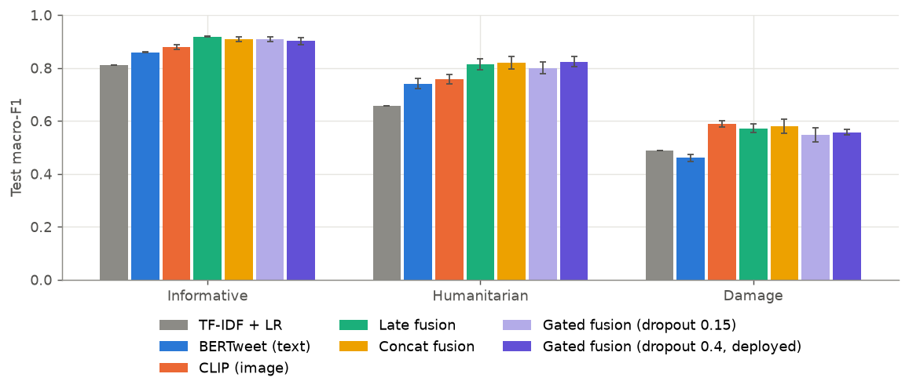
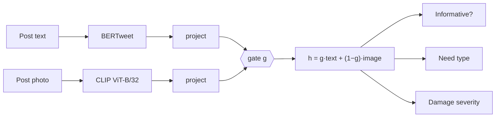

# CrisisLens

**Multimodal triage of disaster social media posts.** CrisisLens reads a post's text and photo together, flags the
ones responders need to see, sorts them by type of need, explains why, and puts them on a map with short, cited
area summaries.

**Live demo:** _add your Space link_ · **Demo video:** _add link_



## Why

During hurricanes, floods, and wildfires, thousands of posts appear every hour. A few show trapped people, collapsed
bridges, or rescue requests; most are noise. Text alone misses what the photo shows, and photos alone miss what the
text says. CrisisLens learns, post by post, how much to trust each.

## Results

CrisisMMD v2.0 test split (official agreed-label splits), macro-F1, mean ± std over 3 seeds. Macro-F1 is the headline
metric because the classes are imbalanced. _Generated by `python -m crisislens.report`; paste `outputs/results.md` here._

| Model | Informative | Humanitarian | Damage | Urgent recall |
| --- | --- | --- | --- | --- |
| TF-IDF + LR (text) | | | | |
| BERTweet (text) | | | | |
| CLIP (image) | | | | |
| Late fusion (avg probs) | | | | |
| Concat fusion | | | | |
| **Gated fusion** | | | | |
| Gated fusion, unseen disaster | | | | |

Also measured: calibration (ECE before/after temperature scaling), urgent-flag precision at 90% recall, accuracy with
the text or image hidden, ONNX int8 size and CPU latency. Figures are in [`figures/`](figures) and
[`notebooks/02_results.ipynb`](notebooks/02_results.ipynb).

## How it works



- **Encoders.** BERTweet (pretrained on 850M tweets) for text; the vision half of CLIP for photos. Both fine-tuned.
- **Gated fusion.** A learned gate mixes the two per dimension and per post. Its average, *image reliance*, says how
  much each prediction leaned on the photo. Missing photos get zero image weight.
- **Multi-task heads.** One shared representation, three heads, losses masked where a post has no label for a task.
- **Modality dropout.** During training, text or image is randomly hidden, so the model still works with one.
- **Leakage guard.** A post that is in dev/test for any task is never trained on for any task.
- **Calibration and flagging.** Temperature scaling on dev; a post is flagged urgent when P(people affected, rescue, or
  damage) passes a threshold chosen on dev for 90% recall.
- **Explanations.** Integrated Gradients (Captum) for words during analysis; occlusion for words and image regions in
  the live demo.
- **Serving.** Exported to ONNX and quantized to int8; the demo and API run on CPU without PyTorch.

## Repository

```
configs/                    one YAML per experiment
src/crisislens/
  data.py                   CrisisMMD loading, tweet normalization, multi-task table, leakage guard
  metrics.py                macro-F1, urgent recall, confusion matrices
  torch_data.py             dataset + collator (text, image, presence flags, per-task labels)
  models/baselines.py       TF-IDF + logistic regression
  models/encoders.py        BERTweet and CLIP loading
  models/fusion.py          text | image | concat | gated, three task heads, modality dropout
  train_baseline.py         baseline training
  train.py                  training loop (Apple MPS / CUDA / CPU), early stopping, predictions
  late_fusion.py            probability averaging, weight picked on dev
  evaluate.py               calibration, flag threshold, missing-modality robustness
  report.py                 results table across seeds
  explain.py                Integrated Gradients + image occlusion panels
  export_onnx.py            ONNX export, int8 quantization, parity and latency checks
  inference.py              torch-free predictor and occlusion explanations
  geo.py                    place extraction + bounded, cached geocoding
  summarize.py              cited area summaries (Gemini / Groq / template), citation checking
scripts/                    check_data, run_experiments, publish_model, build_scenario, deploy_space
notebooks/                  01_eda (data), 02_results (figures)
demo/scenario/              simulated storm: posts.csv, photos, credits, replay.json
app/                        Streamlit demo + Hugging Face Space files
service/api.py              FastAPI: /classify, /explain
tests/                      48 tests on tiny random models, no downloads
docs/DATA.md                dataset terms and how the project complies
```

## Reproduce it

Tested on a MacBook M4 Pro (16 GB). PyTorch uses the Apple GPU (MPS) automatically.

```bash
# 1. Environment (Python 3.11)
python3.11 -m venv .venv && source .venv/bin/activate
pip install -e ".[train,serve,geo,track,dev]"
python -m spacy download en_core_web_sm
nbstripout --install                      # keep notebook outputs (tweets) out of git
pytest -q                                 # 48 tests, about a minute

# 2. Data: download from https://crisisnlp.qcri.org/crisismmd.html into data/crisismmd/
#    CrisisMMD_v2.0.tar.gz  +  crisismmd_datasplit_agreed_label.zip
python scripts/check_data.py --data-dir data/crisismmd

# 3. All experiments (resumable; run overnight, plugged in)
caffeinate -i bash scripts/run_experiments.sh       # add WANDB=1 to log to Weights & Biases

# 4. Export the deployed model
python -m crisislens.export_onnx --run outputs/fusion_gated/seed_42 --out exported/

# 5. Results figures: run notebooks/02_results.ipynb
```

Quick smoke test before the long run: `python -m crisislens.train --config configs/fusion_gated.yaml --max-train-batches 20 --epochs 1`.

## Demo

The demo replays **Hurricane Delphine**, a fictional storm with posts written for this project and public-domain
photos, so no CrisisMMD content is published (see [docs/DATA.md](docs/DATA.md)).

```bash
python scripts/build_scenario.py fetch-images          # public-domain photos + credits; check contact_sheet.jpg
export GEMINI_API_KEY=...                              # optional; template summaries without it
python scripts/build_scenario.py build --model exported/
MODEL_DIR=exported streamlit run app/streamlit_app.py  # local preview

export HF_TOKEN=hf_write... HF_READ_TOKEN=hf_read...
python scripts/publish_model.py --repo <user>/crisislens-model            # private model repo
python scripts/deploy_space.py --space <user>/crisislens --model-repo <user>/crisislens-model
```

API: `MODEL_DIR=exported uvicorn service.api:app --port 8000`, then `POST /classify` with
`{"posts": [{"text": "...", "image_base64": "..."}]}`.

## Data, limitations, responsible use

Trained on [CrisisMMD v2.0](https://crisisnlp.qcri.org/crisismmd.html) (research use only; contents kept
confidential, model kept private). The data is English tweets from 2017, the demo posts are cleaner than real ones,
and location extraction is approximate. CrisisLens is a triage aid: it ranks what people look at first and never
decides who gets help. Details: [docs/DATA.md](docs/DATA.md).

```
Alam, Ofli, Imran. CrisisMMD: Multimodal Twitter Datasets from Natural Disasters. ICWSM 2018.
Ofli, Alam, Imran. Analysis of Social Media Data using Multimodal Deep Learning for Disaster Response. ISCRAM 2020.
```

Code: MIT ([LICENSE](LICENSE)). Photos: public domain, credited in `demo/scenario/sources.csv`.
